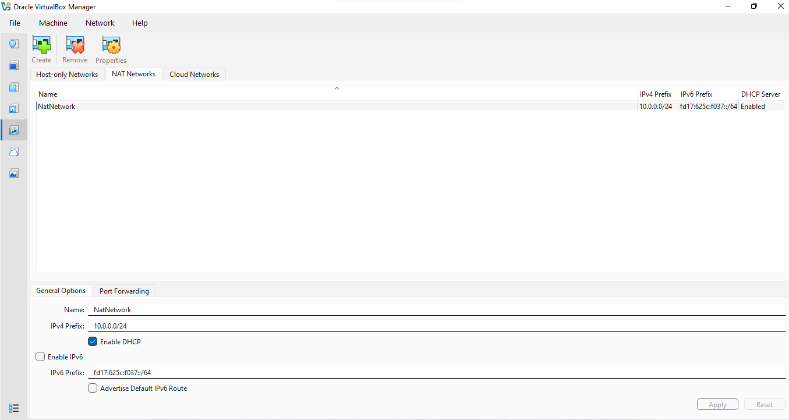
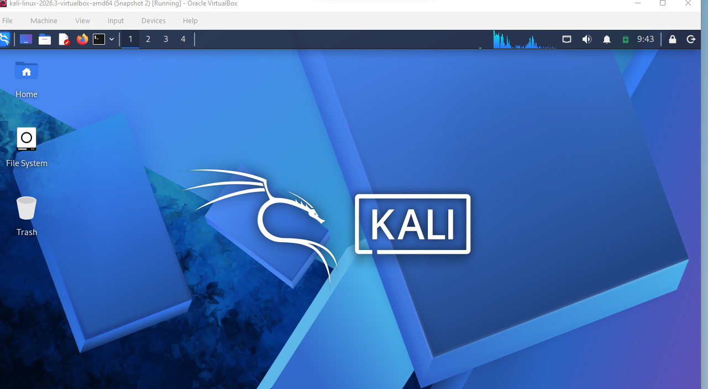
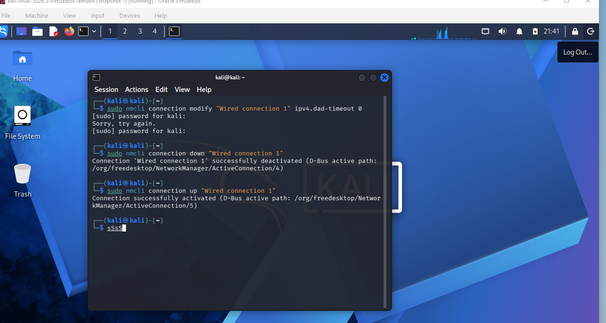
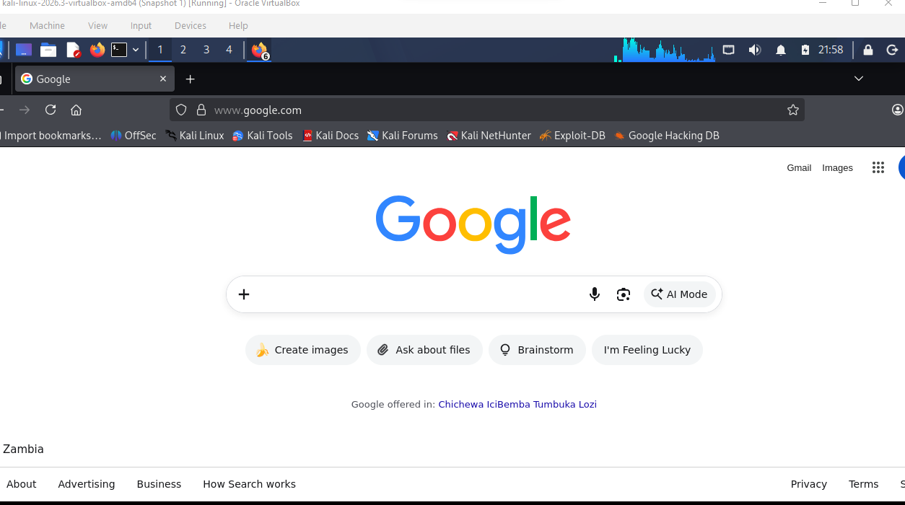

# Cybersecurity & Ethical Hacking Lab Setup: Kali Linux on Oracle VirtualBox

A comprehensive step-by-step technical guide for establishing an isolated, portable cybersecurity testing laboratory using **Kali Linux** and **Oracle VM VirtualBox**. This setup features external storage optimization, custom NAT network configuration, DAD-timeout interface tweaking, and baseline system snapshotting.

<p align="center">
  
  
  
  
  
  
  
  
  
  
  
</p>

---

## 📋 Table of Contents
- [1. Prerequisites \& Tools Used](#1-prerequisites--tools-used)
- [2. Download Optimization Strategy](#2-download-optimization-strategy)
- [3. External Drive Storage Configuration](#3-external-drive-storage-configuration)
- [4. NAT Network Configuration](#4-nat-network-configuration)
- [5. Virtual Machine Import \& Execution](#5-virtual-machine-import--execution)
- [6. Network Troubleshooting \& Interface Management](#6-network-troubleshooting--interface-management)
- [7. Verification \& Network Connectivity Test](#7-verification--network-connectivity-test)
- [8. System Snapshot \& Baseline Recovery](#8-system-snapshot--baseline-recovery)

---

## 1. Prerequisites & Tools Used
* **Hypervisor:** Oracle VM VirtualBox (v7.0+)
* **Guest OS:** Kali Linux (Pre-built VirtualBox Image `.7z`)
* **Storage Location:** External Portable Hard Drive
* **Download Accelerator:** Free Download Manager (FDM)
* **Archive Utility:** 7-Zip
* **Network Protocol:** IPv4 NAT Network (DHCP Enabled)

---

## 2. Download Optimization Strategy
Due to network instability, direct browser downloads of the 3.6 GB Kali Linux image frequently reset to 0%.

### Solution Executed:
1. Downloaded and installed **Free Download Manager (FDM)** from [freedownloadmanager.org](https://freedownloadmanager.org).
2. Saved the raw download path directly to the external drive directory to conserve internal host storage.
3. Extracted the compressed archive (`kali-linux-2026.3-virtualbox-amd64.7z`) using **7-Zip**.

---

## 3. External Drive Storage Configuration
To prevent the guest operating system and future virtual disks from consuming primary host C: drive storage:

1. Opened Oracle VirtualBox Manager.
2. Navigated to **File > Preferences > General**.
3. Set **Default Machine Folder** to point directly to the external portable hard drive (e.g., `E:\VirtualBox VMs`).

---

## 4. NAT Network Configuration
A custom internal NAT Network was configured inside Oracle VirtualBox Manager to enable proper inter-VM routing and gateway traffic:

* **Network Name:** `NatNetwork`
* **IPv4 Prefix:** `10.0.0.0/24`
* **DHCP Server:** Enabled



---

## 5. Virtual Machine Import & Execution
1. Imported the extracted `kali-linux-2026.3-virtualbox-amd64.vbox` appliance into VirtualBox.
2. Verified machine resources (RAM, CPU allocation, Display, and Storage controllers).
3. Attached Network Adapter 1 to **NAT Network** (`NatNetwork`).
4. Booted the Kali Linux VM instance successfully.



---

## 6. Network Troubleshooting & Interface Management
During network setup, Duplicate Address Detection (DAD) timeouts caused temporary connection drops on `Wired connection 1`.

### Commands Executed in Kali Terminal:
To optimize NetworkManager performance and eliminate DAD-related delays, the following terminal commands were executed:



```bash
# Disable DAD timeout on Wired Connection 1
sudo nmcli connection modify "Wired connection 1" ipv4.dad-timeout 0

# Restart network interface to apply settings
sudo nmcli connection down "Wired connection 1"
sudo nmcli connection up "Wired connection 1"
```
---
## 7. Testing Network Connectivity
Following the network troubleshooting and interface adjustments, web browsing was tested inside Kali Linux to confirm active WAN connectivity and secure internet access.

* **URL Tested:** `https://www.google.com`
* **DNS Resolution:** Functional
* **Interface Status:** Active (`Wired connection 1`)


